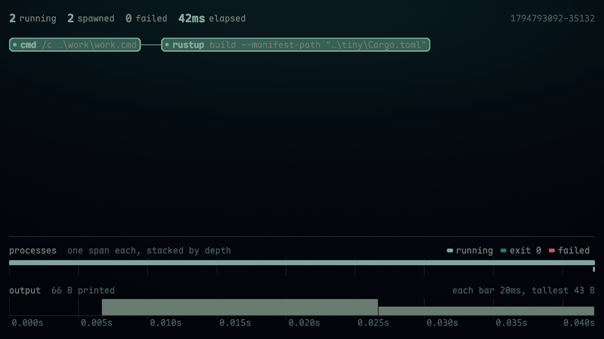
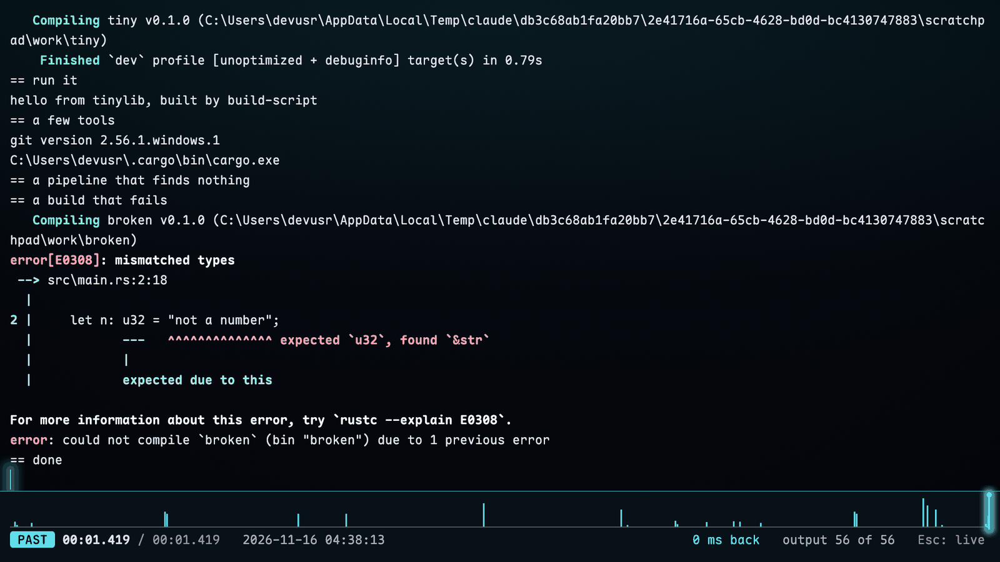
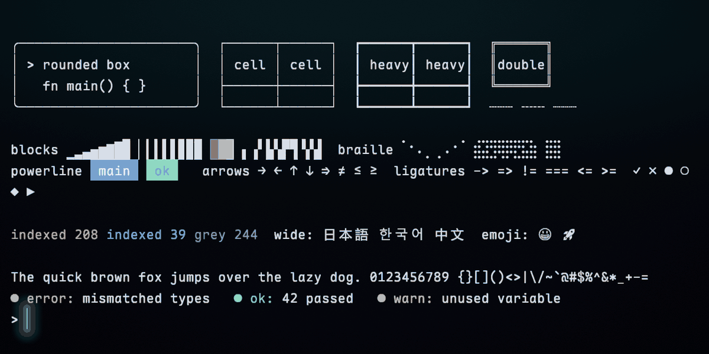
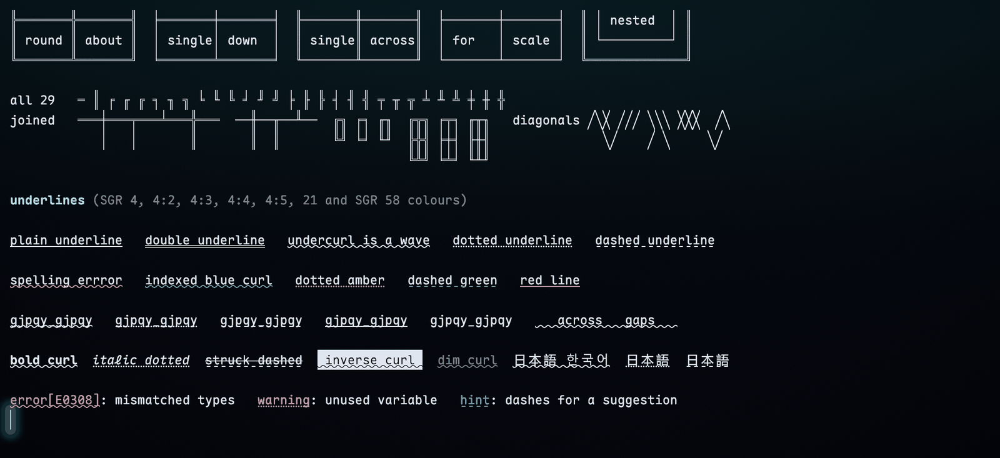

<div align="center">

# PROTEUS

**The terminal is where every command passes. So make it the system of record.**

A GPU terminal for Windows that remembers every session, sees every process, undoes shell commands, and gives AI agents a real terminal to drive over MCP. One 22 MB exe. No install.

[](https://github.com/karimalsalah/proteus/actions/workflows/ci.yml)
[](https://github.com/karimalsalah/proteus/releases/latest)
[](https://github.com/karimalsalah/proteus/releases)
[](LICENSE)


**[Download PROTEUS.exe](https://github.com/karimalsalah/proteus/releases/latest/download/PROTEUS.exe)** · [Code signing policy](CODE_SIGNING_POLICY.md) · [What it does](#what-it-does) · [For agents](#for-ai-agents) · [What is not done](#what-is-not-done) · [Roadmap](forge/roadmap.md)



*A real `cargo build` (and one that fails), replayed from its journal in the world view. Every node is a process the session started, with its command line and exit code, reported by Windows itself. Nothing in this picture is drawn for decoration.*

</div>

---

## Why

Every command you run, and every command your AI agents run, goes through a terminal. Today the terminal forgets all of it the moment it scrolls away. It cannot tell you what a build spawned, which process failed, what the screen said ten minutes ago, or how to put the files back.

PROTEUS keeps all of that:

- **It remembers.** Every session is journaled with timestamps. Any past instant renders exactly, in milliseconds.
- **It senses.** Windows reports every process a session starts (command line, parent, exit code, CPU time) through a job object. No shell hooks.
- **It undoes.** `proteus run -- <cmd>` snapshots the working tree before and after. `proteus chronicle undo` puts it back.
- **It serves agents.** `proteus mcp` gives any MCP client sessions it can spawn, type into, wait on without polling, read without noise, and see as images.
- **It costs nothing when idle.** 0.00% CPU and zero frames drawn while nothing changes, measured on every build.

## What it does

<table>
<tr>
<td width="50%">

**Time travel.** Ctrl+Shift+← steps back through a session, output event by output event. The bar is the session's real output rate over its whole life. Keyframes make any instant reachable in milliseconds; `proteus recall find TEXT` says when text was on screen.

</td>
<td></td>
</tr>
<tr>
<td></td>
<td>

**Light from real events.** Text that lands in an empty cell unfolds and casts light in its own colour. Spinners and in-place edits swap instantly, so an agent's busy indicator costs 9 frames a second, not 100. Nothing animates when nothing happens.

</td>
</tr>
<tr>
<td>

**Drawn by the engine.** Box drawing (light, heavy, rounded, double, mixed junctions), blocks, braille and powerline are drawn by the GPU, not the font, so they join perfectly at any size. Undercurl is a real wave; dotted and dashed underlines take their own colour.

</td>
<td></td>
</tr>
</table>

| | |
|---|---|
| **Sessions outlive windows** | A daemon inside the same exe holds sessions. Close the window, open another, and it picks up exactly where you were. |
| **Undo for the shell** | Content-addressed history of the working tree. Restore is a dry run until you pass `--apply`, never follows links out of the tree, and snapshots first. |
| **Sound from events** | A tick per key, a grain for arriving text, a chime for the bell, rising for success and falling for failure. Computed, not sampled. The audio device sleeps between sounds. |
| **Protocols** | Kitty keyboard protocol (real Shift+Enter for agent UIs), synchronized output, colour queries, OSC 7501 program status (agents that report their state start doing so). |
| **Self-updating** | Checks once a day for a newer release, verifies its Ed25519 signature, size and hash, and applies it at next launch. No downgrades. `"update": "off"` turns it off. |
| **Eyes and ears** | `proteus shot` renders any session, journal or moment to PNG with no window. `proteus ears` renders every sound to WAV. Agents can look at what they did. |

Every number on this page has a command that produced it in [`forge/ledger.json`](forge/ledger.json). The rule in this repository: a claim without a measurement does not get written down.

## Install

**Direct:** download [`PROTEUS.exe`](https://github.com/karimalsalah/proteus/releases/latest/download/PROTEUS.exe) and run it. That is the whole install. It unpacks what it needs (console host, fonts) into `%LOCALAPPDATA%\proteus` on first run and updates itself after that.

**Scoop:**
```powershell
scoop install https://raw.githubusercontent.com/karimalsalah/proteus/main/packaging/scoop/proteus.json
```

> Windows SmartScreen will say "unknown publisher" on first run: the exe is not yet signed with a Windows code-signing certificate (an application to SignPath Foundation is in progress; see the [code signing policy](CODE_SIGNING_POLICY.md)). Choose *More info → Run anyway*, or check the download against the signed `PROTEUS.manifest` in the release.

## For AI agents

PROTEUS is an MCP server. It gives an agent what a person has at a terminal: a real pseudo-console, a screen to look at, and patience.

| Tool | What it does |
|---|---|
| `spawn` | Start a program on a real terminal; a person can watch it live with `proteus --attach N` |
| `send` | Type text and named keys; returns a cursor into the output |
| `wait` | Block until a regex matches, output goes quiet, or the program exits. Event-driven, not polling |
| `read` | Output since a cursor, **lean**: escape codes stripped, progress bars collapsed to their final state, repeats folded, errors never dropped, with raw and lean byte counts |
| `screen` / `shot` | The screen as text or as a PNG, now or as it stood at any earlier moment |
| `sessions` / `kill` | List and end sessions. By default an agent drives only sessions it started |

**Claude Desktop:** download `proteus-mcp.mcpb` from the [latest release](https://github.com/karimalsalah/proteus/releases/latest) and open it.

**Claude Code** (or any MCP client):
```powershell
claude mcp add --scope user --transport stdio proteus -- "C:\path\to\PROTEUS.exe" mcp
```

It is listed in the [MCP Registry](https://registry.modelcontextprotocol.io/) as `io.github.karimalsalah/proteus`.

## Use

```powershell
proteus                          # a window on a new session, or the one you left
proteus sessions                 # what the daemon is running
proteus run -- cargo test        # one undoable step
proteus chronicle undo           # dry run; add --apply to perform it
proteus procs --journal F --tree # every process a session started
proteus recall find "error[E"    # when it was on screen
proteus shot --journal F --until 90 --out then.png
proteus update --check           # is there a newer signed release
```

Keys: **Ctrl+Shift+W** world view · **Ctrl+Shift+←/→** step through time (Home/End: start, now) · **Ctrl+Shift+D** detach (session keeps running) · **Ctrl+Shift+Delete** reset the keyboard protocol if a program died with it on.

Settings live in `%LOCALAPPDATA%\proteus\config.json`: `font_pt`, `reveal`, `light`, `sound`, `volume`, `update`, `shell`, journal retention.

## What is not done

PROTEUS is early: one person's daily terminal, built in the open. Please read this before trusting it with anything.

- **Three views have not been driven by a person yet.** The world view, time scrubbing and `--attach` are tested headless through `proteus shot` (that is how the images above were made). [#5](https://github.com/karimalsalah/proteus/issues/5) asks for the first real try.
- **Agents' own tool commands are seen as processes, not as output.** Harnesses run each command in a separate process. Routing them into PROTEUS sessions is [#3](https://github.com/karimalsalah/proteus/issues/3).
- **Command boundaries are built but not switched on** ([#1](https://github.com/karimalsalah/proteus/issues/1)), and agent status is answered but not shown ([#2](https://github.com/karimalsalah/proteus/issues/2)).
- **Undo covers files in the tracked tree only.** Not network, registry, databases or anything in `.gitignore`.
- **No colour emoji, ligatures or images yet.** Journals are plaintext and hold everything printed, including command lines.
- **Windows only. No sandbox.** PROTEUS observes; it does not contain.
- **Nobody has tuned the sound or the light by ear and eye.**

The [roadmap](forge/roadmap.md) ranks what comes next, each item with the number that proves it worked and the reading that means drop it.

## Build

Windows 11, Rust (MSVC toolchain).

```powershell
cargo build --release            # target\release\proteus.exe is the whole product
cargo test --release
pwsh forge\gate.ps1 -SkipBench   # the headless gate: tests, runs-alone check, sound, screenshots
pwsh forge\gate.ps1              # full gate: real keys into a test window, bench, idle budget
```

## Contributing

The [good first issues](https://github.com/karimalsalah/proteus/issues?q=is%3Aopen+label%3A%22good+first+issue%22) are small and self-contained. Read [CONTRIBUTING.md](CONTRIBUTING.md): measured claims only, nothing mock in tests, the gate must pass, and say plainly what you did not test. Questions and ideas go in [Discussions](https://github.com/karimalsalah/proteus/discussions).

## Licence

MIT ([LICENSE](LICENSE)). [Code signing policy](CODE_SIGNING_POLICY.md) · [Security](SECURITY.md) · [Privacy](CODE_SIGNING_POLICY.md#privacy). PROTEUS embeds Microsoft's ConPTY (MIT) and Maple Mono NF (SIL OFL 1.1). `proteus licenses` prints every bundled notice, including all 178 Rust dependencies.
